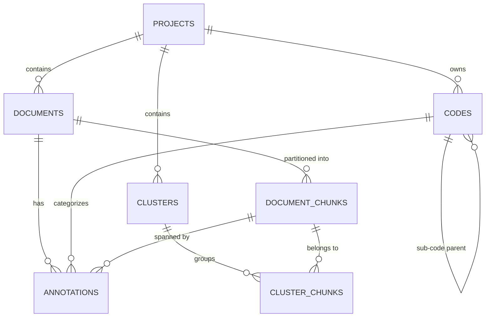

# Design Specification

## 1. Database Architecture & Data Modeling

The Qualitative Data Analysis Tool (QDAT) utilizes an on-device relational and vector storage model built on PostgreSQL 16 with the `pgvector` extension. This architecture supports high-performance qualitative text queries, hierarchical taxonomy management, and dense vector similarity search while strictly adhering to air-gapped data governance rules.

### 1.1 Relational & Vector Entities
The database schema consists of six core entities:
1. **`projects`**: Top-level research workspaces containing documents, codebooks, and analysis sessions.
2. **`documents`**: Full verbatim qualitative transcripts, interviews, or survey responses.
3. **`document_chunks`**: Segmented text passages with exact character coordinates and 384-dimensional dense vectors (`vector(384)`).
4. **`codes`**: Qualitative coding taxonomy with self-referential parent-child hierarchy and color tokens.
5. **`annotations`**: Relational junction connecting codes to exact character coordinate spans (`start_char`, `end_char`) in source documents for verifiable source grounding.
6. **`clusters` / `cluster_chunks`**: Unsupervised semantic groupings discovered through local HDBSCAN / k-means algorithms.

### 1.2 Entity-Relationship Diagram (ERD)



### 1.3 Exact Source Grounding (Coordinate Tracking)
Every qualitative code association is recorded with character coordinate bounds:
- `start_char`: 0-indexed start offset in `documents.raw_content`
- `end_char`: 0-indexed end offset in `documents.raw_content`
- `selected_text`: Verbatim text excerpt

This coordinate system enables bidirectional click-to-cite verification between analytical summaries and the raw transcript in the frontend Document Reader.

### 1.4 Vector Indexing Strategy
- **Index Type:** Hierarchical Navigable Small World (HNSW) index
- **Metric:** Cosine distance (`vector_cosine_ops`)
- **Index Definition:**
  ```sql
  CREATE INDEX idx_chunks_embedding_hnsw 
  ON document_chunks 
  USING hnsw (embedding vector_cosine_ops)
  WITH (m = 16, ef_construction = 64);
  ```

For full implementation and DDL scripts, refer to [schema.sql](file:///Users/home/Downloads/CPTS%20421%20CAPSTONE/PROJECT/code/backend/schema.sql) and [DATABASE_DESIGN.md](file:///Users/home/Downloads/CPTS%20421%20CAPSTONE/PROJECT/code/backend/DATABASE_DESIGN.md).
