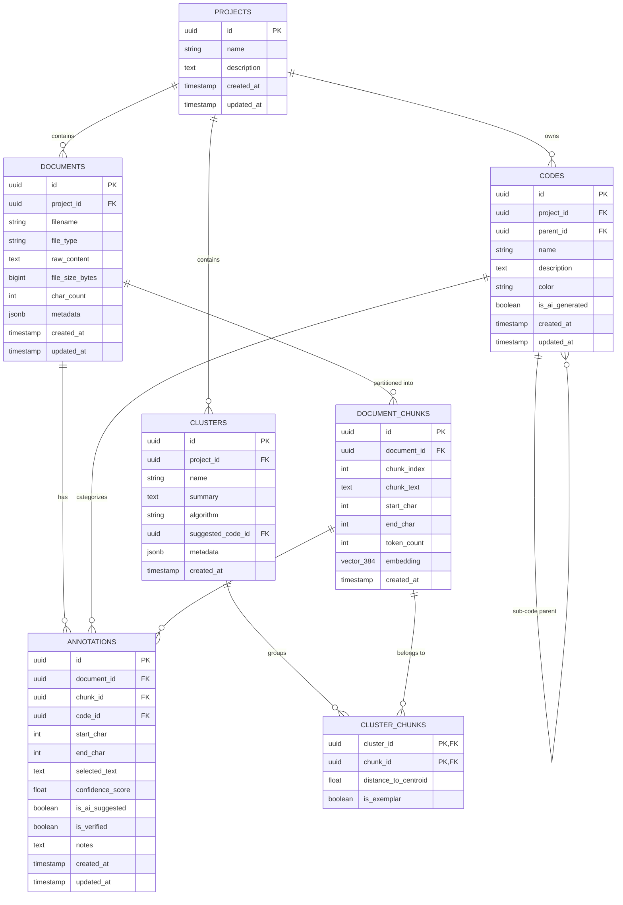

# QDAT Initial Database Schema Design & Architecture Specification

**GitHub Issue Reference:** [#5: Design the initial database schema](https://github.com/BitnaW/QDAT/issues/5)  
**Author / Backend Lead:** Surakanti Srishanth Reddy  
**Project:** Qualitative Data Analysis Tool (QDAT) - Team SEB (Team 1)  
**Client / Sponsors:** Season Hoard & Daniel Mueller (WSU DGSS)  
**Faculty Advisor:** Dr. Parteek Kumar (WSU VCEA)  

---

## 1. Executive Summary & Problem Context

Researchers at the WSU Division of Governmental Studies and Services (DGSS) analyze 40–50+ page transcripts from focus groups, community surveys, and municipal hearings. Due to strict institutional privacy mandates, ethical governance, and non-disclosure agreements, data cannot be sent to commercial cloud APIs (OpenAI, Anthropic). 

QDAT provides a **100% on-device, air-gapped qualitative coding platform**. The database is the core foundation enabling:
1. **Document Storage & Segmentation:** Persisting full transcript text alongside coordinate-bounded chunks.
2. **Dense Semantic Vector Retrieval:** Enabling conceptual search (e.g. searching "fiber delays" and retrieving "broadband hurdles") powered by local `vector(384)` embeddings and HNSW indexing in PostgreSQL.
3. **Exact Source Grounding (Traceability):** Eliminating AI hallucinations and black-box outputs by linking every code, annotation, and thematic cluster to verbatim coordinate offsets (`start_char`, `end_char`) in the raw transcript.
4. **Hierarchical Codebook Management:** Supporting qualitative coding structures (parent codes, sub-categories, UI color tagging).

---

## 2. Task 1: Information That Needs to Be Stored

| Entity | Purpose | Information Stored |
| :--- | :--- | :--- |
| **Projects** | Workspaces for independent studies | Project name, research description, creation/modification timestamps. |
| **Documents** | Qualitative source transcripts | File name, MIME/file type, raw verbatim text content, character count, file size, custom metadata JSON (session, demographics). |
| **Document Chunks** | Text passages partitioned for local vector embedding | Chunk index, chunk text, exact coordinate offsets (`start_char`, `end_char`), token count, 384-dimensional dense vector (`vector(384)`). |
| **Codes** | Qualitative coding taxonomy / codebook | Code name, qualitative definition/criteria, parent code ID (tree hierarchy), hex color code for UI highlights, AI-generated flag. |
| **Annotations** | Source grounding connecting codes to text | Document ID, chunk ID, code ID, start character coordinate, end character coordinate, verbatim selected quote, confidence score, human verification flag, analyst notes. |
| **Clusters & Links** | Unsupervised semantic theme discovery | Cluster name, summary brief, algorithm (HDBSCAN/k-means), distance to centroid, exemplar flag, suggested code mapping. |

---

## 3. Task 2: Table Specifications & Relational Integrity

### 3.1 Relational Architecture Summary
- **`projects` (1) ───< (N) `documents`**: One project contains multiple transcripts or qualitative files.
- **`documents` (1) ───< (N) `document_chunks`**: A document is partitioned into sequential text chunks with coordinate bounds.
- **`projects` (1) ───< (N) `codes`**: Codebooks belong to a specific research project.
- **`codes` (1) ───< (N) `codes` (Self-Referencing)**: Hierarchical parent-child relationship for nested qualitative codes.
- **`documents` (1) ───< (N) `annotations` >─── (1) `codes`**: Many-to-many junction with coordinate attributes linking codes to exact character spans in transcripts.
- **`document_chunks` (1) ───< (N) `annotations`**: Optional foreign key to directly associate an annotation with its vector chunk.
- **`projects` (1) ───< (N) `clusters` ───< (N) `cluster_chunks` >─── (1) `document_chunks`**: Groups chunks into unsupervised semantic themes.

### 3.2 Key Constraints & Business Logic
1. **Coordinate Boundary Integrity:**
   - `CHECK (start_char >= 0 AND end_char > start_char)` ensures invalid or reversed coordinate spans cannot be inserted.
2. **Chunk Sequence Ordering:**
   - `UNIQUE (document_id, chunk_index)` guarantees sequential determinism when reconstructing or navigating passages.
3. **Cascading Relational Integrity:**
   - Foreign keys use `ON DELETE CASCADE` so deleting a project or document automatically cleans up all associated chunks, annotations, and links without orphan records.
4. **Human-in-the-Loop Verification:**
   - `annotations.is_verified` (Boolean) and `confidence_score` (Float between 0.0 and 1.0) allow the UI to clearly distinguish analyst-coded excerpts from AI suggestions awaiting approval.

---

## 4. Task 3: IDs and Source Traceability Architecture

In qualitative research, **verifiability is non-negotiable**. DGSS analysts must be able to click on any suggested code or theme in the UI and immediately see the exact sentence highlighted in the original document.

### 4.1 Identification Strategy
- **UUIDs (`gen_random_uuid()`):** All primary keys (`id`) use Version 4 UUIDs. This prevents ID collisions, enables distributed client-side ID pre-generation, and allows offline synchronization.

### 4.2 Coordinate-Based Source Grounding Model
Rather than storing isolated string snippets, QDAT stores absolute character coordinate tuples:
$$\text{Source Location} = (\text{document\_id}, \text{start\_char}, \text{end\_char})$$

```
Raw Transcript:
"Participant 1: Our local broadband access has been completely unreliable..."
 ^              ^                                                           ^
 0              15 (start_char)                                             156 (end_char)
```

1. **Storage:** The `annotations` table records `start_char = 15` and `end_char = 156`.
2. **Retrieval:** The frontend fetches the document text and slice offsets: `raw_content.slice(start_char, end_char)`.
3. **Synchronized Highlighting:** React maps these coordinate ranges into CSS mark/highlight components in the Document Reader pane.
4. **Bidirectional Navigation:** Clicking a code in the Codebook tree filters all annotations with `code_id`, jumping the reader to `start_char`. Conversely, selecting text in the reader auto-fills the coordinate span for creating a new annotation.

---

## 5. Task 4: Database Entity-Relationship Diagram (ERD)



---

## 6. Vector Indexing: HNSW (Hierarchical Navigable Small World)

- **Vector Dimension:** `384` dimensions, matching `all-MiniLM-L6-v2` from Sentence Transformers (high performance, lightweight local inference).
- **Distance Operator:** Cosine distance `<=>` in pgvector:
  $$\text{Cosine Distance} = 1 - \frac{u \cdot v}{\|u\|_2 \|v\|_2}$$
- **Index Type:** **HNSW** (`USING hnsw (embedding vector_cosine_ops) WITH (m = 16, ef_construction = 64)`)
  - **Why HNSW over IVFFlat?** IVFFlat requires an initial training step and suffers significant recall loss when documents are added incrementally. HNSW provides graph-based approximate nearest neighbor search that works out-of-the-box on dynamic uploads with sub-10ms query times on local CPU workstations.

---

## 7. Review & Acceptance Criteria Checklist

| Acceptance Criterion | Implementation Status | Verification Location |
| :--- | :--- | :--- |
| Identify all information to be stored | Completed | Section 2 & `schema.sql` |
| Plan tables and relational integrity | Completed | Section 3 & `code/backend/app/db/models.py` |
| Define IDs for exact source text traceability | Completed | Section 4 (`start_char`, `end_char`, UUIDs) |
| Create simple database diagram | Completed | Section 5 (Mermaid ERD) |
| Local containerization blueprint | Completed | `deployment/docker-compose.yml` (`pgvector:pg16`) |
| Seed verification data | Completed | Focus group sample data in `schema.sql` |

**Conclusion:** The database schema design fulfills all criteria of Issue #5, aligns directly with DGSS institutional requirements, and is ready for Sprint 2 backend integration.
