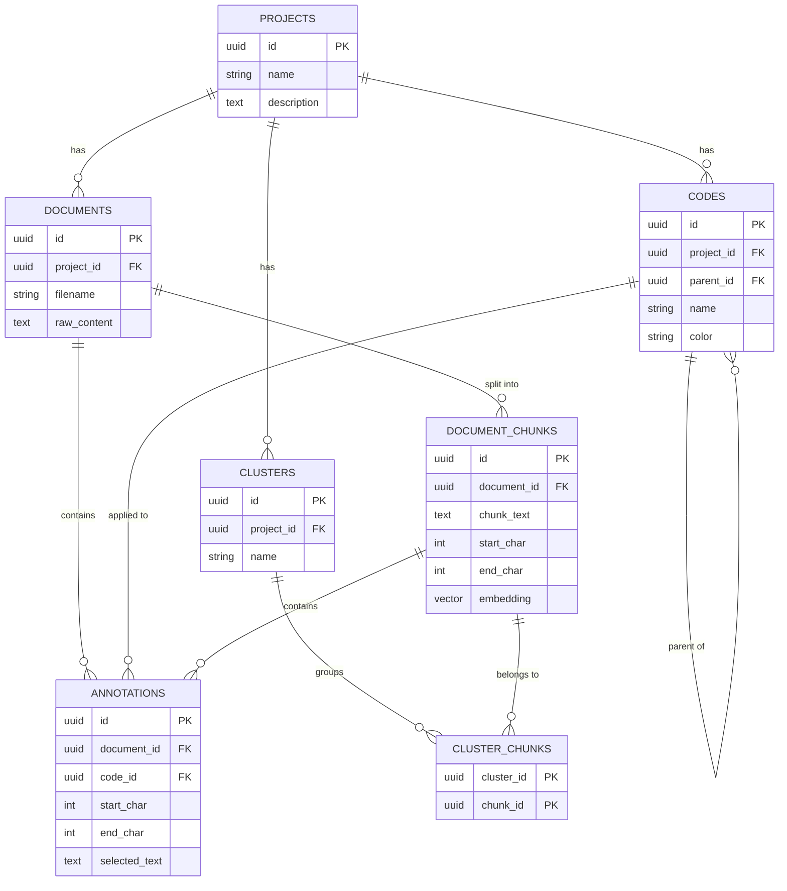

## Database Schema Design (Issue #5)

### Overview
We designed the initial database schema for QDAT to store projects, uploaded transcripts, text segments, and codes, with full traceability back to the original text. 

The implementation is complete on branch `feature/issue-5-database-schema` using **PostgreSQL + pgvector**.

---

### 1. Information That Needs to Be Stored

* **Projects:** Project name and description (keeps different research studies separate).
* **Documents:** Uploaded transcripts, filenames, file types (txt, docx, pdf), and the full raw text.
* **Document Chunks:** Smaller segments of each document, their text, character positions, and vector embeddings (for semantic search).
* **Codes:** Qualitative codes/tags (like "Broadband Issues" or "Social Trust"), definitions, colors for highlighting, and parent codes (for nested sub-codes).
* **Annotations:** Highlights that connect a specific code to an exact quote in a document.
* **Clusters:** Groups of similar text passages found by machine learning algorithms.

---

### 2. Tables and Relationships

* **`projects`**: Top-level container.
* **`documents`**: Belongs to a project.
* **`document_chunks`**: Belongs to a document. Contains the text piece and its vector embedding.
* **`codes`**: Belongs to a project. Can also link to another parent code for sub-categories.
* **`annotations`**: Connects a **code** to a **document** (and optionally a chunk) at an exact text location.
* **`clusters` & `cluster_chunks`**: Connects grouped chunks together for theme discovery.

**Key Rule:** If a project or document is deleted, all related chunks, codes, and annotations are automatically cleaned up (`ON DELETE CASCADE`).

---

### 3. How Codes Connect to Source Text (Traceability)

To make sure every code links back to the exact words in the transcript, an annotation stores:

1. **`document_id`**: Which document the quote is from.
2. **`code_id`**: Which code is being applied.
3. **`start_char` and `end_char`**: The exact character numbers where the quote starts and ends in the document.
4. **`selected_text`**: The verbatim quote itself.

**How it works in the app:**
* When a user clicks a code in the list, the app uses `start_char` and `end_char` to jump directly to that sentence and highlight it with the code's color.
* When a user selects text on screen, the app grabs the start and end position and saves the new annotation.

---

### 4. Database Diagram

---

### 5. Review with Team

* **Backend (Srishanth):** Ready-to-run SQL schema and SQLAlchemy models with PostgreSQL and pgvector.
* **NLP (Bitna):** Chunks store 384-dimension vector embeddings ready for clustering and semantic search.
* **Frontend (Evan):** Simple character coordinates (`start_char`, `end_char`) and color codes ready for text highlighting.
* **Clients (DGSS):** Everything runs 100% locally on the laptop so sensitive research data never leaves the computer.

---

### Deliverables Created (Branch: `feature/issue-5-database-schema`)

* `code/backend/schema.sql` - Complete SQL schema with sample data.
* `code/backend/app/db/models.py` - Python database models for the backend.
* `code/backend/DATABASE_DESIGN.md` - Full design details and documentation.
* `deployment/docker-compose.yml` - Docker setup to start the database with one command (`docker compose up`).
